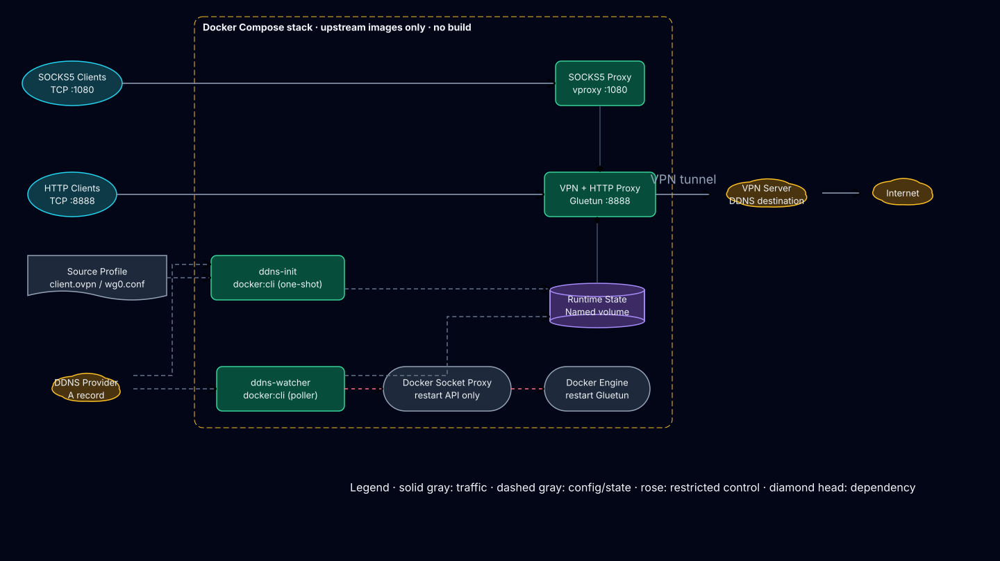
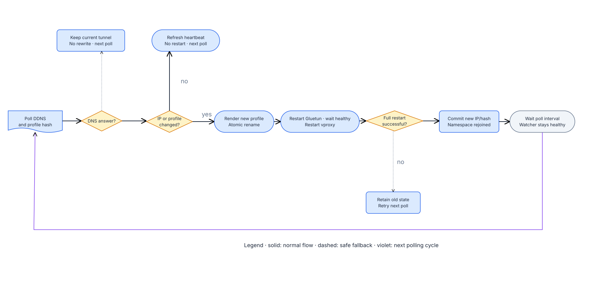

# DDNS VPN Proxy

以純 Docker Compose 部署、DDNS-aware 的 VPN HTTP／SOCKS5 proxy。專案不含 Dockerfile、
不建置自有 image；遠端主機只要放入 VPN profile，便能直接 `docker compose up`。

成熟的 VPN client runtime 在啟動時需要**已解析的 IP endpoint**，或在 endpoint IP
改變後不會自行重連。自架 VPN server 常只有 DDNS hostname。本專案只補這個缺口：
驗證 profile、解析 hostname、產生 runtime profile，並在 A record 或 profile／憑證
改變時以固定順序安全重啟 backend、等 tunnel 就緒後才提交狀態。VPN 協定、kill
switch、健康檢查、HTTP 與 SOCKS5 proxy 都交給 version-pinned 的上游服務。

正式契約在 [docs/spec.md](docs/spec.md)。



## 支援的連線方式

| `VPN_TYPE` | Backend（stack file） | 協定 | Proxy 認證 | 成熟度 |
| --- | --- | --- | --- | --- |
| `openvpn` | Gluetun（`docker-compose.yml`，預設） | OpenVPN custom profile | HTTP＋SOCKS5 | Stable |
| `wireguard` | Gluetun（`docker-compose.yml`） | WireGuard single-peer | HTTP＋SOCKS5 | Stable |
| `openconnect` | OpenConnect（`docker-compose.openconnect.yml`） | AnyConnect／ocserv、GlobalProtect、Pulse、F5、Fortinet、Array | 無（loopback-only） | Beta |
| `singbox` | sing-box（`docker-compose.singbox.yml`） | Shadowsocks、VMess、VLESS、Trojan、Hysteria2、TUIC、ShadowTLS、AnyTLS、SSH | HTTP＋SOCKS5 | Beta |

所有 backend 共用同一套 DDNS 解析、原子寫入、restart chain、restart-only Docker
API 與 container hardening。每個 backend 的細節：
[OpenConnect](docs/backends/openconnect.md)、[sing-box](docs/backends/singbox.md)；
Gluetun 在 [架構文件](docs/architecture.md)。

IPv6 endpoint、OpenVPN multi-remote、WireGuard multi-peer、SOCKS5 UDP ASSOCIATE、
IKEv2／L2TP／SSTP 不在目前契約內（原因見 [spec §1.4、§13.1](docs/spec.md)）。

## 特色

- **零 build**：只拉取版本固定的上游 image；`docker compose config` 中沒有 `build:`。
- **先準備、後啟動**：`ddns-init` 成功驗證、解析並 render profile 前，VPN
  container 不會啟動；設定錯誤以 exit 64 立即失敗。
- **不中斷優先**：暫時 DNS 失敗時保留現有 tunnel，不覆寫 profile、不重啟。
- **不因 DNS round-robin 抖動**：舊 IP 仍在 A record 集合內時繼續使用。
- **自動恢復**：DDNS IP、profile 或被引用的憑證／金鑰改變後，原子更新 runtime
  profile、重啟 backend、等就緒探測成功、（Gluetun）再重啟 SOCKS5 sidecar，全部
  成功才提交狀態；任一步失敗下一輪完整重試。
- **最小 Docker socket 權限**：watcher 不掛載 socket；HAProxy allowlist 由
  `RESTART_TARGETS` 產生，只允許 `/_ping` 與指定 container 的 restart。
- **Secrets 不進 helper**：helper 只收到 credential-presence 布林。
- **安全預設**：proxy 只綁定 `127.0.0.1`；所有非 VPN container `cap_drop: ALL`、
  `no-new-privileges`、read-only root；只有 Gluetun／OpenConnect 有 `NET_ADMIN`。
- **協定可擴充**：新增一種 VPN 連線方式＝一個 adapter 檔＋一個 stack file，流程在
  [spec §13](docs/spec.md)。

## 五分鐘部署

### 1. 準備環境

Linux 主機、Docker Engine 25+、Docker Compose v2.24+；Gluetun／OpenConnect backend 另需
`/dev/net/tun`：

```bash
docker version
docker compose version
test -c /dev/net/tun
```

### 2. 放入 VPN profile

放入 `VPN_CONFIG_DIR`，profile 保留 DDNS hostname；被引用的憑證／金鑰放同一目錄。

OpenVPN（預設）：

```bash
mkdir -p config/openvpn
install -m 600 /path/provider.ovpn config/openvpn/client.ovpn
```

```ovpn
client
proto udp
remote vpn.example.com 1194 udp
ca ca.crt
cert client.crt
key client.key
```

WireGuard：

```bash
mkdir -p config/wireguard
install -m 600 /path/wg0.conf config/wireguard/wg0.conf
```

OpenConnect（[說明](docs/backends/openconnect.md)）：

```bash
mkdir -p config/openconnect
install -m 600 examples/openconnect/client.conf config/openconnect/client.conf
```

sing-box（[說明](docs/backends/singbox.md)）：

```bash
mkdir -p config/sing-box
install -m 600 examples/sing-box/config.json config/sing-box/config.json
```

### 3. 建立設定

```bash
cp .env.example .env
chmod 600 .env
```

OpenVPN 本機部署可保留預設。其他連線方式改 `VPN_TYPE`、profile 位置，並用
`COMPOSE_FILE` 選擇 stack：

```dotenv
# WireGuard
VPN_TYPE=wireguard
VPN_CONFIG_DIR=./config/wireguard
VPN_CONFIG_FILE=wg0.conf

# OpenConnect
VPN_TYPE=openconnect
COMPOSE_FILE=docker-compose.openconnect.yml
VPN_CONFIG_DIR=./config/openconnect
VPN_CONFIG_FILE=client.conf
OPENCONNECT_SERVER=vpn.example.com
OPENCONNECT_USER=alice
OPENCONNECT_PASSWORD=replace-with-the-vpn-password

# sing-box
VPN_TYPE=singbox
COMPOSE_FILE=docker-compose.singbox.yml
VPN_CONFIG_DIR=./config/sing-box
VPN_CONFIG_FILE=config.json
```

要讓 LAN 其他主機使用（Gluetun／sing-box backend），先設定兩組 credentials 再改
bind address；validator 與 `ddns-init` 都會拒絕「公開綁定但沒有完整認證」：

```dotenv
PROXY_BIND_ADDRESS=0.0.0.0
HTTPPROXY_USER=http-user
HTTPPROXY_PASSWORD=replace-with-a-long-random-password
SOCKS5_USER=socks-user
SOCKS5_PASSWORD=replace-with-another-long-random-password
```

### 4. 驗證並啟動

```bash
make validate   # rendered Compose 契約 + 用真實 helper container 驗證 profile
make up
```

只用 Compose 也可以（`COMPOSE_FILE` 從 `.env` 讀取）：

```bash
docker compose pull
docker compose up -d --wait --wait-timeout 180
```

### 5. 驗證 proxy

```bash
docker compose ps
curl -x http://127.0.0.1:8888 https://ifconfig.me
curl --socks5-hostname 127.0.0.1:1080 https://ifconfig.me
```

有認證時加 `-U 'USER:PASSWORD'`。兩個結果都應是 VPN 出口 IP。

## DDNS 變更時會發生什麼



1. watcher 每 `DDNS_POLL_SECONDS` 秒解析 DDNS，並計算 profile（含被引用檔案）的
   SHA-256 fingerprint。
2. DNS 失敗只記錄 warning，保留現有 tunnel。
3. IP 與 fingerprint 都未變時只更新 heartbeat。
4. 有變化時先寫暫存檔，再 atomic rename 取代 runtime profile。
5. 經 `docker-socket-proxy` restart VPN container，輪詢 backend 的就緒探測
   （Gluetun health server、OpenConnect tunnel gate、sing-box Clash API URL test）。
6. Gluetun backend 再 restart vproxy，確認 `:1080` 出現在新的 network namespace。
7. 整條 chain 成功才提交 `last-ip` 與 fingerprint；否則下一輪完整重試。

## 常用操作

```bash
make help
make status
make logs
make restart
make down        # 保留 runtime state volume
make clean       # 同時刪除可重新產生的 runtime state
make check       # docs lint、Compose 契約、離線行為測試、真實 container 契約
make shellcheck  # 以 pinned ShellCheck image 靜態檢查
```

詳細操作與故障排除見 [操作手冊](docs/operations.md)。

## Production checklist

- 使用真實 provider profile；`.env` 與 `config/` 不進版控。
- proxy 對外開放時兩組 credentials 都要完整；OpenConnect backend 永遠 loopback。
- host firewall 限制 `8888/tcp`、`1080/tcp` 來源。
- 保留版本固定的 image tag；升級前先 `make check`。
- 監控 VPN container、`ddns-watcher` 的 Docker health 與 `level=ERROR`／`WARN` log。
- 確認 Docker socket 只有 `docker-socket-proxy` 掛載、`docker-api` network 沒有
  published port。

## 文件

- [規格（正式契約）](docs/spec.md)
- [架構與設計決策](docs/architecture.md)
- [部署、升級與故障排除](docs/operations.md)
- [測試策略與驗收](docs/testing.md)
- [OpenConnect backend](docs/backends/openconnect.md)
- [sing-box backend](docs/backends/singbox.md)
- [變更記錄](CHANGELOG.md)

## 上游元件

| 元件 | 預設版本 | 責任 |
| --- | --- | --- |
| [Docker CLI](https://hub.docker.com/_/docker) | `29.6.1-cli-alpine3.24` | 執行 POSIX helper 與 restart client |
| [Docker Socket Proxy](https://github.com/Tecnativa/docker-socket-proxy) | `v0.4.2` | restart-only Docker API |
| [Gluetun](https://github.com/qdm12/gluetun) | `v3.41.1` | OpenVPN／WireGuard、kill switch、health、HTTP proxy |
| [vproxy](https://github.com/0x676e67/vproxy) | `v2.5.5` | Gluetun stack 的 SOCKS5 sidecar |
| [openconnect-proxy](https://github.com/wazum/openconnect-proxy) | `2.1.0` | OpenConnect tunnel、tunnel gate、HTTP／SOCKS5 |
| [sing-box](https://sing-box.sagernet.org/) | `v1.14.2` | proxy-protocol outbound、mixed inbound |

版本集中在 `.env`，可明確 review 後升級，不使用 `latest` 等 moving tag。

## License

[MIT](LICENSE)
